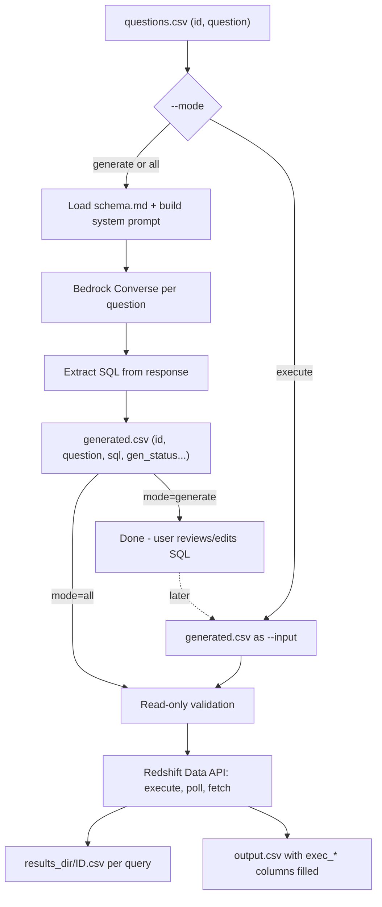

# VibeQuery: Natural Language to Redshift SQL CLI - Design

VibeQuery is a Python CLI. It reads a CSV of natural-language questions and turns each one into Amazon Redshift SQL using Amazon Bedrock (Converse API, configurable model ID), with the full Markdown schema document in context. It can then run the SQL on Redshift Serverless through the Redshift Data API. Generation and execution can run as separate phases.

Builds on the existing skeleton: [pyproject.toml](../pyproject.toml), [src/vibequery/__main__.py](../src/vibequery/__main__.py). Python >= 3.11.

## 1. Requirements

### Functional
- FR1: Accept a CSV of natural-language questions (`--input`).
- FR2: Load one Markdown schema document verbatim into the system prompt (no RAG, no chunking).
- FR3: System prompt states the target is **Amazon Redshift** (Redshift SQL dialect) and the tables are those described in the schema doc.
- FR4: Call Amazon Bedrock with a **configurable model ID** (any Converse-compatible model, including inference profile IDs like `us.anthropic...`).
- FR5: A `--mode` flag picks the phase:
  - `generate`: question to SQL only.
  - `execute`: run SQL from a previously generated (and possibly hand-edited) CSV.
  - `all`: generate, then execute.
- FR6: Execute SQL on **Redshift Serverless** via the **Redshift Data API** (boto3 `redshift-data`).
- FR7: Output a CSV with one row per question (status, SQL, errors, metadata). Each executed query's result set goes to its own CSV in `--results-dir`.
- FR8: Per-row failures never abort the batch. They are recorded in the output row.
- FR9: Read-only guard: by default only single `SELECT`/`WITH` statements are executed. `--allow-writes` overrides this.

### Non-functional
- Runs locally using the standard AWS credential chain (`AWS_PROFILE` / SSO / env vars).
- Deterministic generation (`temperature=0`), bounded retries (botocore adaptive retry).
- Bounded execution: `--max-rows` (default 1000) and `--query-timeout` (default 300s, cancels the statement on timeout).
- Configurable concurrency (`--concurrency`, default 4) using threads.
- Exit codes: `0` all rows ok, `1` one or more rows failed, `2` usage/config error.
- Minimal deps: `boto3`, `sqlparse`. Dev: `pytest`.

### Out of scope (this phase)
- RAG / schema retrieval, self-correction loops (retry on SQL error), conversation memory, resume-from-partial-run, a UI.

## 2. User Flow



Typical phased usage:

```bash
# Phase 1: generate SQL only
vibequery --mode generate --input questions.csv --schema schema.md \
  --model-id us.anthropic.claude-sonnet-4-20250514-v1:0 --output generated.csv

# (optional) human reviews / edits the `sql` column in generated.csv

# Phase 2: execute on Redshift Serverless
vibequery --mode execute --input generated.csv --output results.csv \
  --workgroup analytics-wg --database dev --results-dir results/

# One shot
vibequery --mode all --input questions.csv --schema schema.md --output results.csv ...
```

## 3. CLI Specification (single command, argparse)

- `--mode {generate,execute,all}` (required)
- `--input PATH` (required), `--output PATH` (required), `--overwrite` (otherwise error if output exists)
- `--config PATH` optional TOML file (default: `./vibequery.toml` if present)
- Generation: `--schema PATH` (required for generate/all), `--model-id`, `--max-tokens` (default 2048), `--temperature` (default 0.0), `--system-prompt-file PATH` (optional override of the built-in template; must contain `{schema}`)
- Execution: `--workgroup`, `--database`, `--secret-arn` (optional; default is IAM auth), `--results-dir` (default `./results`), `--max-rows` (1000), `--query-timeout` (300), `--allow-writes`
- AWS: `--region`, `--profile`
- Runtime: `--concurrency` (4), `-v/--verbose`

Config precedence: CLI flag > env var > TOML file > default. Env vars: `VIBEQUERY_MODEL_ID`, `VIBEQUERY_WORKGROUP`, `VIBEQUERY_DATABASE`, `VIBEQUERY_SECRET_ARN`, `AWS_REGION`, `AWS_PROFILE`.

Example `vibequery.toml`:

```toml
[bedrock]
model_id = "us.anthropic.claude-sonnet-4-20250514-v1:0"
max_tokens = 2048
temperature = 0.0

[redshift]
workgroup = "analytics-wg"
database = "dev"
max_rows = 1000
query_timeout = 300

[aws]
region = "us-east-1"
```

## 4. File Formats

### Input CSV (mode generate/all)
- Required column: `question`. Optional: `id` (if missing/blank, assign `q0001`, `q0002`, ... by row order). Extra columns are passed through unchanged.
- `id` must be unique and filename-safe (`[A-Za-z0-9_-]+`), validated on load. Duplicates cause exit code 2.

### Input CSV (mode execute)
- Required: `id`, `sql`. Normally the output of `generate`. All existing columns are preserved. Rows with empty `sql` or `gen_status != ok` get `exec_status=skipped`.

### Output CSV (UTF-8, `csv` module with `QUOTE_MINIMAL`; multi-line SQL is safely quoted)
Column order: passthrough input columns first, then:
- `id`, `question`, `sql`
- `gen_status` (`ok` | `cannot_answer` | `error`), `gen_error`, `model_id`, `gen_latency_ms`, `input_tokens`, `output_tokens`
- `exec_status` (`ok` | `error` | `blocked` | `skipped` | `timeout`, empty in generate mode), `exec_error`, `statement_id`, `row_count`, `truncated` (true/false), `result_file`, `exec_latency_ms`

Rows are written in input order.

### Result CSVs
- `<results_dir>/<id>.csv`: header = Redshift column names. Values come from Data API typed fields, with NULL written as an empty string.

## 5. Low-Level Design

### Package layout

```
src/vibequery/
  __main__.py         # calls cli.main()
  cli.py              # argparse, wiring, exit codes
  config.py           # Settings dataclasses + load_settings()
  models.py           # QueryRecord, enums
  csv_io.py           # read_records, write_records, write_result_csv
  schema.py           # load_schema
  prompts.py          # SYSTEM_PROMPT_TEMPLATE, build_system_prompt
  sql_extract.py      # extract_sql
  sql_guard.py        # validate_read_only
  bedrock_client.py   # BedrockSqlGenerator
  redshift_client.py  # RedshiftDataApiExecutor
  pipeline.py         # generate_all, execute_all, run
tests/
  test_csv_io.py, test_sql_extract.py, test_sql_guard.py,
  test_prompts.py, test_bedrock_client.py, test_redshift_client.py, test_pipeline.py
```

`pyproject.toml` additions: `dependencies = ["boto3>=1.34", "sqlparse>=0.5"]`, `[project.optional-dependencies] dev = ["pytest"]`, `[project.scripts] vibequery = "vibequery.cli:main"`.

### models.py

```python
class GenStatus(StrEnum): OK="ok"; CANNOT_ANSWER="cannot_answer"; ERROR="error"
class ExecStatus(StrEnum): OK="ok"; ERROR="error"; BLOCKED="blocked"; SKIPPED="skipped"; TIMEOUT="timeout"

@dataclass
class QueryRecord:
    id: str
    question: str = ""
    sql: str = ""
    gen_status: GenStatus | None = None
    gen_error: str = ""
    model_id: str = ""
    gen_latency_ms: int | None = None
    input_tokens: int | None = None
    output_tokens: int | None = None
    exec_status: ExecStatus | None = None
    exec_error: str = ""
    statement_id: str = ""
    row_count: int | None = None
    truncated: bool | None = None
    result_file: str = ""
    exec_latency_ms: int | None = None
    extra: dict[str, str] = field(default_factory=dict)  # passthrough columns
```

### config.py
- `@dataclass BedrockSettings(model_id, max_tokens, temperature)`, `RedshiftSettings(workgroup, database, secret_arn, max_rows, query_timeout, allow_writes)`, `AwsSettings(region, profile)`, `Settings(mode, input, output, overwrite, schema_path, system_prompt_path, results_dir, concurrency, verbose, bedrock, redshift, aws)`.
- `load_settings(args: argparse.Namespace) -> Settings`: merge TOML (`tomllib`), env, args. Then `validate()` raises `ConfigError` (exit 2), for example when `model_id`/`schema` is missing in generate/all, or `workgroup`/`database` is missing in execute/all.
- `make_session(aws: AwsSettings) -> boto3.Session`.

### csv_io.py
- `read_records(path, mode) -> list[QueryRecord]`: `csv.DictReader`. Validates required columns per mode, assigns ids, checks uniqueness/charset, and maps known columns into fields with the rest into `extra`. In execute mode it parses existing `gen_*` columns back.
- `write_records(path, records, overwrite)`: writes to `path.tmp` then `os.replace` (atomic).
- `write_result_csv(path, columns: list[str], rows: list[list]) -> None`.

### schema.py
- `load_schema(path) -> str`: read UTF-8 and strip. Error if empty. Log a warning if `len(text)/4 > 150_000` estimated tokens (risk of exceeding model context).

### prompts.py

```python
SYSTEM_PROMPT_TEMPLATE = """You are an expert data analyst who writes SQL for Amazon Redshift.
All tables live in Amazon Redshift. Use only Redshift-compatible SQL syntax and functions;
Redshift is PostgreSQL-derived but does not support every PostgreSQL feature.

Rules:
- Use ONLY the tables and columns described in the schema document below. Never invent tables or columns.
- Always schema-qualify table names exactly as written in the schema document.
- Produce exactly one read-only statement (SELECT or WITH ... SELECT). No DDL/DML.
- Prefer explicit column lists over SELECT *.
- If the question cannot be answered from the schema, respond with
  <cannot_answer>short reason</cannot_answer> and nothing else.
- Otherwise respond with the SQL wrapped in <sql></sql> tags and nothing else.

<schema_document>
{schema}
</schema_document>"""

def build_system_prompt(schema: str, template: str | None = None) -> str
def build_user_message(question: str) -> str  # f"Question: {question}"
```

Use `str.replace("{schema}", schema)` rather than `.format` (schema may contain braces).

### sql_extract.py
- `extract_sql(text) -> tuple[GenStatus, str, str]` returns `(status, sql, error)`:
  1. If `<cannot_answer>...</cannot_answer>` is present, return CANNOT_ANSWER with the reason in `error`.
  2. Else if `<sql>...</sql>` is present, use its inner text.
  3. Else fall back to the first ```` ```sql ... ``` ```` fenced block.
  4. Else ERROR "no SQL found in model response".
  - Strip whitespace and one trailing `;`.

### sql_guard.py
- `validate_read_only(sql) -> str | None` returns an error message or None.
  - `sqlparse.split` must produce exactly 1 non-empty statement.
  - `sqlparse.parse(sql)[0].get_type()` must be `SELECT`, or the first keyword must be `WITH` with no DML type.
  - Reject if any token (comments stripped via `sqlparse.format(strip_comments=True)`) matches the denylist: `INSERT UPDATE DELETE MERGE DROP ALTER CREATE TRUNCATE GRANT REVOKE COPY UNLOAD CALL VACUUM ANALYZE`.
- Note in README: real protection = run with an IAM identity / DB user that only has SELECT grants. The guard is a safety net.

### bedrock_client.py

```python
@dataclass
class GenerationResult:
    status: GenStatus; sql: str; error: str
    latency_ms: int; input_tokens: int | None; output_tokens: int | None; raw_text: str

class BedrockSqlGenerator:
    def __init__(self, session, settings: BedrockSettings, system_prompt: str): ...
        # client = session.client("bedrock-runtime",
        #   config=Config(retries={"max_attempts": 5, "mode": "adaptive"}, read_timeout=120))
    def generate(self, question: str) -> GenerationResult:
        # client.converse(
        #   modelId=settings.model_id,
        #   system=[{"text": system_prompt}],
        #   messages=[{"role": "user", "content": [{"text": build_user_message(question)}]}],
        #   inferenceConfig={"maxTokens": ..., "temperature": ...})
        # text = join of response["output"]["message"]["content"][*]["text"]
        # usage = response["usage"] (inputTokens/outputTokens)
        # status, sql, err = extract_sql(text)
        # on ClientError/BotoCoreError -> GenStatus.ERROR with message (never raises)
```

The system prompt (schema) is identical for every call. Optionally append `{"cachePoint": {"type": "default"}}` to `system` behind a `--prompt-cache` flag for models that support it (nice-to-have, off by default).

### redshift_client.py

```python
@dataclass
class ExecutionResult:
    status: ExecStatus; error: str; statement_id: str
    columns: list[str]; rows: list[list]; row_count: int; truncated: bool; latency_ms: int

class RedshiftDataApiExecutor:
    def __init__(self, session, settings: RedshiftSettings): ...
        # client = session.client("redshift-data")
    def execute(self, sql: str) -> ExecutionResult:
        # 1. execute_statement(WorkgroupName=..., Database=..., Sql=sql,
        #       [SecretArn=...] if set)  -> Id
        # 2. poll describe_statement(Id) with backoff 0.5s -> max 5s until Status in
        #    FINISHED | FAILED | ABORTED; if elapsed > query_timeout: cancel_statement(Id) -> TIMEOUT
        # 3. FAILED/ABORTED -> ERROR with describe["Error"]
        # 4. FINISHED and HasResultSet: page get_statement_result(Id, NextToken)
        #    columns from ColumnMetadata[*]["name"]; stop once rows >= max_rows (truncated=True)
        # 5. FINISHED and no result set -> OK, row_count = ResultRows
        # never raises; ClientError -> ERROR

def _field_value(field: dict):
    # {"isNull": True} -> None; else first of stringValue/longValue/doubleValue/booleanValue/blobValue
```

### pipeline.py

```python
def generate_all(records, generator, concurrency) -> None
    # ThreadPoolExecutor; for each record with non-empty question:
    # fill sql, gen_status, gen_error, model_id, gen_latency_ms, tokens
    # empty question -> gen_status=error, gen_error="empty question"

def execute_all(records, executor, settings, results_dir, concurrency) -> None
    # for each record:
    #   if not sql or gen_status not in (None, ok): exec_status=skipped
    #   elif not allow_writes and (err := validate_read_only(sql)): exec_status=blocked, exec_error=err
    #   else: res = executor.execute(sql); if ok and columns: write_result_csv(results_dir/f"{id}.csv")
    #   fill exec_* fields; result_file stored relative to cwd

def run(settings) -> int  # returns exit code
    # records = read_records(input, mode)
    # if mode in (generate, all): build prompt, generate_all
    # if mode in (execute, all): execute_all
    # write_records(output); log summary counts by status to stderr
    # return 1 if any gen_status==error or exec_status in (error, timeout) else 0
```

Records are mutated in place, so output order = input order. boto3 clients are thread-safe when created once and shared.

### cli.py
- `build_parser() -> ArgumentParser`, `main(argv=None) -> None`: parse, `load_settings`, configure `logging` (stderr, INFO, or DEBUG with `-v`), `sys.exit(pipeline.run(settings))`. `ConfigError`/`FileNotFoundError` cause a message and exit 2.
- `__main__.py` calls `cli.main()`.

## 6. AWS Prerequisites (document in README)
- Bedrock model access enabled for the chosen model in the region.
- IAM permissions for the local identity: `bedrock:InvokeModel` (Converse), `redshift-data:ExecuteStatement`, `DescribeStatement`, `GetStatementResult`, `CancelStatement`, `redshift-serverless:GetCredentials` (IAM auth), or `secretsmanager:GetSecretValue` if using `--secret-arn`.
- The Redshift Serverless IAM-mapped user needs SELECT on the schemas in the schema doc (ideally SELECT only).

## 7. Testing
- Unit: `extract_sql` (tags, fences, cannot_answer, garbage), `validate_read_only` (SELECT, WITH, multi-statement, DML, comment-hidden DML), `csv_io` (id assignment, duplicate ids, multi-line SQL round-trip, passthrough columns), `build_system_prompt` (braces in schema).
- Clients: `botocore.stub.Stubber` for `converse`, `execute_statement`/`describe_statement`/`get_statement_result` (pagination, truncation, FAILED, timeout leading to cancel).
- Pipeline: fake generator/executor, which checks skipped/blocked logic, exit codes, and execute-mode preserving generated columns.
- Add `examples/questions.csv` and `examples/schema.md` for manual smoke runs.

## 8. Implementation Order
1. Update `pyproject.toml` (deps, script entry point) and create module skeletons per the layout.
2. Implement `models`, `config`, `csv_io`, `schema`, `prompts`, `sql_extract`, `sql_guard`.
3. Implement `BedrockSqlGenerator` (Converse) and `RedshiftDataApiExecutor` (Serverless Data API).
4. Implement `pipeline` (`generate_all`, `execute_all`, `run`) and the argparse CLI with `--mode`.
5. Add the pytest suite (Stubber-based), example files, and README usage plus IAM prerequisites.
